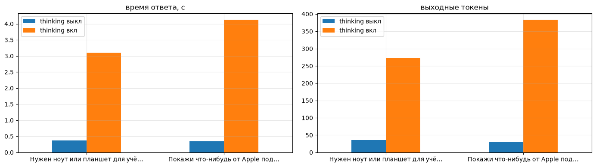
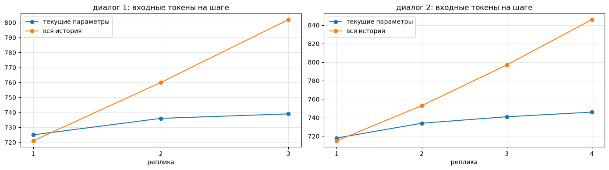

# Отчёт по лабораторной работе №1. Пайплайны обработки данных на основе LangChain и LLM

Все эксперименты - в ноутбуке `Lab1_Novikova.ipynb`, общий код - в `utils.py`, база - `init_db.py`, итоговая программа - `app.py`, зависимости - `requirements.txt`, инструкция запуска - `README.md`.

## Цель работы

Научиться строить простейшего агента в виде пайплайна: LLM интерпретирует запрос на естественном языке и возвращает параметры в согласованном формате (структурированный ответ или вызов инструмента), а обычная программа проверяет эти параметры и выполняет действие — поиск товаров в SQLite. Дополнительно: обработать ошибки разбора повторными попытками, вести журнал выполнения и хранить состояние диалога вне модели.

## Архитектура

```
запрос пользователя (+ текущие параметры поиска, если это уточнение)
        │
        ▼
ChatPromptTemplate: system = правила + инструкции формата (или "вызови search_products")
                    human  = запрос
        │
        ▼
┌──────── with_retry: до 3 попыток, повтор только при OutputParserException ────────┐
│  LLM (ChatOpenAI -> qwen)  ──►  разбор ответа:                                     │
│                                 • PydanticOutputParser: текст -> JSON -> ProductQuery│
│                                 • или tool_calls -> ProductQuery.model_validate     │
└────────────────────────────────────────────────────────────────────────────────────┘
        │  ProductQuery (уже прошёл проверку Pydantic)
        ▼
проверка параметров: category = other -> в БД не идём; нет цены -> подтверждение
        │
        ▼
search_products(): SQL собирает программа из разрешённых полей, значения через ? -> SQLite
        │
        ▼
ответ пользователю                   каждый шаг пишется в журнал (Journal -> logs/*.log)
```

LLM не формирует и не выполняет SQL, она только превращает текст в `ProductQuery`. Всё дальше — детерминированный код.

| Файл | Что внутри |
|---|---|
| `utils.py` | `get_llm`, схема `ProductQuery`, промпты, `build_sql` / `search_products`, инструмент `search_products_tool`, журнал `Journal`, `build_pipeline` (retry), `ask` (обработка ошибок) |
| `init_db.py` | создание `catalog.db` |
| `Lab1_Novikova.ipynb` | эксперименты по частям 1–5 |
| `app.py` | консольная программа: диалог с уточнениями, `--tools`, `--verbose`, `/new`, `/log` |

---

## Часть 1. Базовая цепочка LangChain

Промпт: `system` - роль модели (определить категорию товара) и переменная `{language}`, `human` - `{query}`. Цепочка `prompt | llm | StrOutputParser()`.

| Вызов | Что возвращает |
|---|---|
| `prompt.invoke(...)` | `ChatPromptValue` — список `[SystemMessage, HumanMessage]` с подставленными переменными |
| `llm.invoke(prompt_value)` | `AIMessage`: `content='Запрос относится к категории ноутбуков.'`, `usage_metadata`: 82 входных / 9 выходных токенов |
| `chain.invoke(...)` | `TextAccessor` (наследник `str`, `isinstance(res, str) = True`) — только текст ответа |

`batch` из 5 запросов:

| query | language | Ответ |
|---|---|---|
| Найди ноутбуки дешевле 70 000 рублей | русский | Запрос относится к категории ноутбуки. |
| Покажи самые дорогие смартфоны | английский | Your request belongs to the smartphones category. |
| Хочу посмотреть планшеты | русский | Ваш запрос относится к категории планшетов. |
| Найди холодильники | русский | Запрос относится к категории крупной бытовой техники. |
| Нужен телефон с хорошей камерой | немецкий | Sie suchen ein Smartphone. |

- переменная `language` работает, промпт параметризован
- ответы свободным текстом каждый раз сформулированы по-разному, а для холодильников модель придумала свою категорию - такой текст программа надежно не разберет, отсюда нужен структурированный вывод
- batch занял 60.5 с при ~0.4 с на одиночный вызов - скорее всего, очередь на общем сервере, поэтому по этому замеру скорость batch не оценить

---

## Часть 2. Structured Output и Pydantic

### 2.1. Схема

```python
class ProductQuery(BaseModel):
  model_config = ConfigDict(extra='forbid')
  category: Literal['laptop', 'smartphone', 'tablet', 'other'] = Field(description=...)  # обязательное
  max_price: Optional[int] = Field(default=None, ge=0, description=...)                 # None = без ограничения
  sort_by: Literal['price_asc', 'price_desc'] = Field(default='price_asc', description=...)
```

В описании `category` сказано, что неподдерживаемые товары -> `other`. `extra='forbid'` добавлен, чтобы опечатка в ключе (`"price"` вместо `"max_price"`) давала ошибку и retry, а не молча превращалась в «цена не ограничена».

### 2.2. Инструкции формата

`PydanticOutputParser(pydantic_object=ProductQuery).get_format_instructions()` вставляется в **системный** промпт через `prompt.partial(format_instructions=...)` (иначе фигурные скобки JSON-схемы шаблон принял бы за переменные). Кроме них в системном промпте правила: только три категории, иначе `other`; «50к», «50 тысяч» -> 50000; «дешевле/до/не дороже X» -> `max_price`; «самые дорогие» -> `price_desc`.

Цепочка `prompt | llm | parser` возвращает объект `ProductQuery` (`isinstance = True`), сериализация: `q.model_dump_json()` -> `{"category":"laptop","max_price":80000,"sort_by":"price_asc"}`.

### 2.3. Тестирование

Результаты также сохранены в `tests_2_3.json`.

| № | Запрос | Что проверяем | Полученный JSON | category | max_price | sort_by | Итог |
|---|---|---|---|---|---|---|---|
| 1 | Найди ноутбуки дешевле 70 000 рублей | категория и числовое ограничение | `{"category":"laptop","max_price":70000,"sort_by":"price_asc"}` | + | + | + | верно |
| 2 | Покажи самые дорогие смартфоны | сортировка по убыванию | `{"category":"smartphone","max_price":null,"sort_by":"price_desc"}` | + | + | + | верно |
| 3 | Хочу посмотреть планшеты | нет ограничения цены | `{"category":"tablet","max_price":null,"sort_by":"price_asc"}` | + | + | + | верно |
| 4 | Покажи ноутбуки до 50 тысяч | нормализация числа | `{"category":"laptop","max_price":50000,"sort_by":"price_asc"}` | + | + | + | верно |
| 5 | Найди холодильники | неизвестная категория | `{"category":"other","max_price":null,"sort_by":"price_asc"}` | + | + | + | верно |

**Итого 5 из 5**

Свои неоднозначные запросы:

| Запрос | JSON | Как система поняла |
|---|---|---|
| Нужен ноут или планшет для учёбы, бюджет где-то 60к | `{"category":"laptop","max_price":60000,"sort_by":"price_asc"}` | взяла первую названную категорию, планшеты потеряны; «где-то 60к» стало жёстким потолком, поэтому найдётся только Lenovo за 54 990, а ASUS за 61 490 отсекается |
| Покажи что-нибудь от Apple подороже | `{"category":"other","max_price":null,"sort_by":"price_desc"}` | бренда в схеме нет -> `other`, программа ответит «такие товары не продаются», **хотя в базе 5 товаров Apple** во всех трёх категориях (iPad Pro 13 M4, iPhone 16 Pro Max, MacBook Air 13 M3, iPhone 15, iPad Air 11 M2); «подороже» понято как `price_desc` |

Что не влезает в схему (несколько категорий, бренд, "примерная" цена), то теряется - для пользователя запрос про Apple получил неверный ответ.

### 2.4. Режим размышления

Та же цепочка на двух неоднозначных запросах с `enable_thinking=False` и `True` (для `True` - `temperature=0.6`, `max_tokens=8000`).

| Запрос | thinking | Параметры | Парсер | Время, с | Вход. токены | Выход. токены | `<think>` в content |
|---|---|---|---|---|---|---|---|
| Нужен ноут или планшет для учёбы, бюджет где-то 60к | выкл | laptop, 60000, price_asc | ок | 0.37 | 655 | 36 | нет |
| Нужен ноут или планшет для учёбы, бюджет где-то 60к | вкл | laptop, 60000, price_asc | ок | 3.10 | 691 | 273 | нет |
| Покажи что-нибудь от Apple подороже | выкл | other, None, price_desc | ок | 0.34 | 647 | 30 | нет |
| Покажи что-нибудь от Apple подороже | вкл | other, None, price_desc | ок | 4.12 | 683 | 383 | нет |



С размышлением время больше в **10.1 раз**, выходных токенов больше в **9.9 раз**, параметры совпали в 2 из 2 запросов. Отдельно число reasoning-токенов сервер не возвращает — они входят в выходные.

Сырой ответ сервера (через `openai`-клиент, запрос 1, thinking вкл):
- поля `message`: `content`, `role`, `reasoning_content`, `provider_specific_fields`
- `content`: `'\n\n{"category":"laptop","max_price":60000,"sort_by":"price_asc"}'` — только JSON
- `reasoning_content`: 1317 символов, начало: «Нужно ответить только JSON. Запрос: "Нужен ноут или планшет для учёбы, бюджет где-то 60к". Категория: пользователь хочет ноут или планшет, т.е. не одна конкретная категория из enum?…»
- в `AIMessage` из LangChain ключи `additional_kwargs` - только `refusal`: `ChatOpenAI` поле `reasoning_content` выбрасывает

**Где рассуждение.** Модель сначала генерирует рассуждение между `<think>` и `</think>`, потом ответ. Сервер отделяет рассуждение в поле `reasoning_content`, а в `content` остаётся только JSON, поэтому `PydanticOutputParser` справился во всех случаях. Если бы сервер этого не делал, рассуждение пришло бы прямо в `content`, и парсер упал бы с `JSONDecodeError` (на этот случай в ноутбуке есть `strip_think`)

**Почему рассуждение не должно попадать в разбираемый текст:** это черновик на естественном языке, в нём бывают фигурные скобки и промежуточные варианты ответа, которые модель потом отбросила (в нашем рассуждении она перебирает категории). Парсер мог бы упасть или вытащить не тот JSON. Для извлечения трёх полей размышление ничего не дало (параметры те же, а время и токены ×10), поэтому в остальных заданиях оно выключено

---

## Часть 3. Вызов классического ПО

### 3.1. Каталог

Таблица `products(id, name, category, price)` в `catalog.db`, создаётся `init_db.py`. 19 товаров:

| Категория | Кол-во | Мин. цена | Макс. цена |
|---|---|---|---|
| laptop | 7 | 54 990 | 159 990 |
| smartphone | 7 | 18 990 | 139 990 |
| tablet | 5 | 14 990 | 149 990 |

Цены подобраны так, чтобы часть запросов давала пустой результат (ноутбуков дешевле 54 990 и смартфонов дешевле 18 990 нет)

### 3.2. Программный поиск

`search_products(q: ProductQuery)`: SQL собирается из фиксированных кусков, значения передаются только параметрами `?`, направление сортировки — из белого списка `{'price_asc': 'ASC', 'price_desc': 'DESC'}`

| ProductQuery | SQL | params | Статус | Результат |
|---|---|---|---|---|
| laptop, 70000, price_asc | `... WHERE category = ? AND price <= ? ORDER BY price ASC, id` | `[laptop, 70000]` | ok | Lenovo IdeaPad Slim 3 15 — 54 990; ASUS Vivobook 16 — 61 490; Acer Aspire 5 — 67 990 |
| laptop, 50000, price_asc | `... WHERE category = ? AND price <= ? ORDER BY price ASC, id` | `[laptop, 50000]` | empty | Подходящих товаров не найдено |
| smartphone, None, price_desc | `... WHERE category = ? ORDER BY price DESC, id` | `[smartphone]` | ok | 7 смартфонов от 139 990 до 18 990 |
| tablet, 15000, price_asc | `... AND price <= ? ORDER BY price ASC, id` | `[tablet, 15000]` | ok | Xiaomi Redmi Pad SE — 14 990 |
| tablet, 100000, price_desc | `... AND price <= ? ORDER BY price DESC, id` | `[tablet, 100000]` | ok | 4 планшета от 69 990 до 14 990 |
| other, None, price_asc | — | — | unsupported | Такие товары в каталоге не продаются |

**Поведение для `category = other`:** в базу не идём (иначе пришлось бы показать весь каталог), `search_products` бросает `UnsupportedCategoryError`, пользователь видит «Такие товары в каталоге не продаются. Есть только ноутбуки, смартфоны и планшеты.»

Попытка передать в `category` строку `laptop' OR 1=1; DROP TABLE products; --` до SQL не доходит: `ValidationError` - значение не входит в `Literal`

### 3.3. Объединение компонентов — сравнительная таблица запросов

Цепочка: `parse_prompt | llm | parser | RunnableLambda(run_search)` — на выходе найденные товары.

| Запрос пользователя | Структурированные параметры | Найденные товары | Корректность |
|---|---|---|---|
| Найди ноутбуки дешевле 70 000 рублей | laptop, 70000, price_asc | Lenovo IdeaPad Slim 3 15 — 54 990; ASUS Vivobook 16 — 61 490; Acer Aspire 5 — 67 990 | + |
| Покажи самые дорогие смартфоны | smartphone, None, price_desc | Apple iPhone 16 Pro Max — 139 990; Samsung Galaxy S24 Ultra — 119 990; Apple iPhone 15 — 79 990; … (7 шт.) | + |
| Хочу посмотреть планшеты | tablet, None, price_asc | Xiaomi Redmi Pad SE — 14 990; HUAWEI MatePad 11.5 — 29 990; … (5 шт.) | + |
| Покажи ноутбуки до 50 тысяч | laptop, 50000, price_asc | Подходящих товаров не найдено | + |
| Найди холодильники | other, None, price_asc | Такие товары в каталоге не продаются | + |
| Покажи самые дешевые ноутбуки до 80 тысяч рублей | laptop, 80000, price_asc | Lenovo 54 990; ASUS 61 490; Acer 67 990; HUAWEI 74 990; HONOR 79 990 | + |
| Смартфон не дороже 30к | smartphone, 30000, price_asc | Xiaomi Redmi Note 13 — 18 990; POCO X6 Pro — 27 990 | + |
| Какие есть планшеты до 15 тысяч? | tablet, 15000, price_asc | Xiaomi Redmi Pad SE — 14 990 | + |
| Самые дорогие планшеты, но не дороже 100 000 | tablet, 100000, price_desc | Apple iPad Air 11 M2 — 69 990; Samsung Galaxy Tab S9 FE — 39 990; HUAWEI MatePad 11.5 — 29 990; Xiaomi Redmi Pad SE — 14 990 | + |
| Нужны наушники до 10 тысяч | other, 10000, price_asc | Такие товары в каталоге не продаются | + |
| Смартфоны дешевле 15000 рублей | smartphone, 15000, price_asc | Подходящих товаров не найдено | + |
| Покажи айфоны | smartphone, None, price_asc | все 7 смартфонов от 18 990 | + (формально) |

**Корректно 12 из 12.** «Покажи айфоны» разобран правильно с точки зрения схемы, но пользователь получит все 7 смартфонов, а не 2 iPhone из базы - бренда в схеме нет.

**Сравнение с ответом без базы** (`system`: «Ты консультант интернет-магазина электроники. Отвечай коротко.»):

| Вопрос | Ответ LLM без базы | Что есть в каталоге | Совпало товаров / цен |
|---|---|---|---|
| Какие ноутбуки дешевле 70 000 рублей есть в каталоге? | «У меня нет доступа к вашему текущему каталогу и актуальным ценам. Пожалуйста, уточните модель или бренд…» | Lenovo IdeaPad Slim 3 15, ASUS Vivobook 16, Acer Aspire 5 | 0/3, 0/3 |
| Какие самые дорогие смартфоны есть в каталоге? | «У меня нет доступа к вашему текущему каталогу. Пожалуйста, уточните, какой именно магазин…» | 7 смартфонов, первый — Apple iPhone 16 Pro Max | 0/7, 0/7 |
| Какие планшеты до 15 тысяч рублей есть в каталоге? | «У меня нет доступа к вашему текущему каталогу и актуальным ценам… пришлите список моделей» | Xiaomi Redmi Pad SE — 14 990 | 0/1, 0/1 |

Модель честно говорит, что каталога не видит, и не называет ни одного нашего товара. Ничего не выдумала, но и пользы нет: что есть именно у нас и за сколько, она знать не может. Пайплайн на те же вопросы даёт точный список из базы, а модель в нём отвечает только за понимание запроса.

### 3.4. Поиск как инструмент

Функция оформлена как `@tool("search_products", args_schema=ProductQuery)` с описанием в docstring, привязана через `llm.bind_tools([search_products_tool])`. Аргументы вызова сначала проверяются `ProductQuery.model_validate(args)`, потом выполняется поиск; результат модели не возвращается. Если вызова нет — показываем текст модели, в базу не идём.

| Запрос | content | tool_calls | Проверка | Результат поиска | Корректность | Как в части 2 |
|---|---|---|---|---|---|---|
| Найди ноутбуки дешевле 70 000 рублей | '' | `search_products({category: laptop, max_price: 70000, sort_by: price_asc})` | + | 3 ноутбука до 67 990 | + | да |
| Покажи самые дорогие смартфоны | '' | `search_products({category: smartphone, sort_by: price_desc})` | + | 7 смартфонов | + | да |
| Хочу посмотреть планшеты | '' | `search_products({category: tablet})` | + | 5 планшетов | + | да |
| Покажи ноутбуки до 50 тысяч | '' | `search_products({category: laptop, max_price: 50000, sort_by: price_asc})` | + | не найдено | + | да |
| Найди холодильники | '' | `search_products({category: other})` | + | не продаются | + | да |
| Нужен ноут или планшет для учёбы, бюджет где-то 60к | '' | **два вызова**: `laptop, 60000` и `tablet, 60000` | + | взят только первый: Lenovo IdeaPad Slim 3 15 — 54 990 | неоднозначный | да |
| Покажи что-нибудь от Apple подороже | '' | `search_products({category: laptop, sort_by: price_desc})` | + | 7 ноутбуков, первый ASUS ROG Strix G16 | неоднозначный | нет (в части 2 — `other`) |
| Привет! Расскажи анекдот | анекдот | `[]` | вызова нет | поиск не выполнялся | + | — |

- на запросах из 2.3 - 5 из 5, совпадает с частью 2. Аргументы со значением по умолчанию модель иногда не передаёт, их подставляет Pydantic
- на «ноут или планшет» модель сделала два параллельных вызова — через инструменты неоднозначность выражается лучше, чем одним JSON, но наш код берёт только первый вызов, и планшеты теряются (надо выполнять все вызовы)
- «Apple подороже» тут ушёл в `laptop` вместо `other`, но это тоже мимо: в выдаче нет iPhone и iPad, а первым идёт ASUS
- на анекдот модель не вызвала инструмент - этот случай обработан отдельно

**Сравнение с частью 2:**

| | Инструкции формата (часть 2) | Вызов инструмента (3.4) |
|---|---|---|
| где описана схема | в тексте системного промпта (`get_format_instructions()`) | в отдельном поле `tools` запроса (схема из `args_schema`), шаблон чата модели встраивает её в промпт |
| кто достаёт параметры из текста модели | приложение: `PydanticOutputParser` ищет JSON в `content` | сервер: парсер вызовов вырезает вызов из сгенерированного текста и отдаёт `tool_calls`; `langchain-openai` даёт `msg.tool_calls` с готовым `dict` |
| кто проверяет | Pydantic внутри парсера | приложение: `ProductQuery.model_validate(args)`, сервер схему не гарантирует |
| кто выполняет действие | приложение | приложение (результат модели не отдаём) |
| если модель «не хочет» искать | текст вместо JSON -> ошибка парсинга -> retry | нет вызова — нормальный случай, обрабатывается отдельно |

---

## Часть 4. Retry и журнал выполнения

### 4.1. Анализ ошибок

Невалидные «ответы модели» составлены вручную и переданы в `PydanticOutputParser`:

| Тип проблемы | Ответ модели | Исключение | `__cause__` | Подробности | Где возникает |
|---|---|---|---|---|---|
| синтаксис JSON: нет запятой | `{"category": "laptop" "max_price": 70000, ...}` | OutputParserException | JSONDecodeError | Expecting ',' delimiter | текст -> JSON |
| синтаксис JSON: текст вместо JSON | `Конечно! Вот ноутбуки до 70 тысяч: ...` | OutputParserException | JSONDecodeError | Expecting value | текст -> JSON |
| синтаксис JSON: одинарные кавычки | `{'category': 'laptop', 'max_price': 70000}` | OutputParserException | JSONDecodeError | Expecting property name enclosed in double quotes | текст -> JSON |
| перечисление: категории нет | `{"category": "fridge", ...}` | OutputParserException | ValidationError | `literal_error` | JSON -> ProductQuery |
| перечисление: сортировка | `{"sort_by": "cheap_first", ...}` | OutputParserException | ValidationError | `literal_error` | JSON -> ProductQuery |
| ограничение: отрицательная цена | `{"max_price": -5000, ...}` | OutputParserException | ValidationError | `greater_than_equal` | JSON -> ProductQuery |
| тип: цена словами | `{"max_price": "семьдесят тысяч", ...}` | OutputParserException | ValidationError | `int_parsing` | JSON -> ProductQuery |
| тип: дробная цена | `{"max_price": 69999.5, ...}` | OutputParserException | ValidationError | `int_from_float` | JSON -> ProductQuery |
| лишнее поле | `{"category": "laptop", "price": 70000}` | OutputParserException | ValidationError | `extra_forbidden` | JSON -> ProductQuery |

Наружу всегда вылетает `OutputParserException`, настоящая причина — в `__cause__`:
1. **Синтаксически некорректный JSON** -> `JSONDecodeError`: первый этап внутри парсера (`parse_json_markdown`), текст не превращается в `dict`, до Pydantic дело не доходит.
2. **Значение не из перечисления** -> `ValidationError` (`literal_error`): JSON разобран, ошибка на втором этапе — проверке по схеме.
3. **Неверный тип / нарушение ограничения** -> `ValidationError` (`int_parsing`, `int_from_float`, `greater_than_equal`, `extra_forbidden`): тоже второй этап.

Все три класса ошибок возникают на шаге парсинга — после вызова LLM и до поиска, поэтому невалидные параметры до базы не доходят; на `OutputParserException` настроен retry.

Что похоже на ошибку, но проходит (поэтому такие примеры не подходят): нет закрывающей скобки (парсер разбирает неполный JSON), JSON в блоке ```` ```json ````, цена строкой `"70000"` и `70000.0` (Pydantic в обычном режиме приводит к `int`).

### 4.2–4.3. Повторные попытки и журнал

```python
core = make_llm_step(model, journal) | make_parse_step(journal, tools)
core = core.with_retry(stop_after_attempt=3,                               # всего 3 попытки
                       retry_if_exception_type=(OutputParserException,),   # только ошибки разбора
                       wait_exponential_jitter=False)
pipeline = prompt | core | make_search_step(journal, confirm=..., search_fn=...)  # поиск вне retry
```

Повторяются только генерация и парсинг, поиск стоит после `with_retry` и при повторах не выполняется. Если все попытки неудачны, `ask()` ловит исключение и показывает «Не получилось разобрать запрос … Попробуйте переформулировать», программа не падает. Без ограничения цены перед поиском запрашивается подтверждение (в `app.py` — `input()`, в ноутбуке — автоматически «да»).

Журнал на настоящей модели (фрагмент):

```
16:33:37.840 | req=2 | request        | запрос пользователя: 'Хочу посмотреть планшеты'
16:33:37.843 | req=2 | llm_start      | вызов LLM, попытка 1
16:33:38.180 | req=2 | llm_end        | ответ за 0.34 с, токенов вход/выход: 643/30
16:33:38.185 | req=2 | parse_ok       | JSON разобран
16:33:38.188 | req=2 | validate_ok    | параметры прошли проверку ProductQuery: {"category":"tablet","max_price":null,"sort_by":"price_asc"}
16:33:38.190 | req=2 | check          | категория поддерживается, параметры ок
16:33:38.191 | req=2 | confirm        | подтверждено: искать без ограничения цены
16:33:38.192 | req=2 | search_start   | поиск в SQLite: tablet, None, price_asc
16:33:38.195 | req=2 | search_end     | найдено товаров: 5
16:33:38.197 | req=2 | done           | Найдено товаров: 5
16:33:38.585 | req=4 | request        | запрос пользователя: 'Найди холодильники'
16:33:38.588 | req=4 | llm_start      | вызов LLM, попытка 1
16:33:38.932 | req=4 | llm_end        | ответ за 0.34 с, токенов вход/выход: 641/30
16:33:38.937 | req=4 | parse_ok       | JSON разобран
16:33:38.940 | req=4 | validate_ok    | параметры прошли проверку ProductQuery: {"category":"other","max_price":null,"sort_by":"price_asc"}
16:33:38.942 | req=4 | check          | категория 'other' не поддерживается -> в БД не идём
16:33:38.945 | req=4 | done           | Такие товары в каталоге не продаются. Есть только ноутбуки, смартфоны и планшеты.
```

Все 4 запроса на настоящей модели разобраны с первой попытки (~0.35 с, 641–650 входных и 30–36 выходных токенов). `search_start` везде идёт только после `validate_ok` и `check`.

### 4.4. Воспроизводимый тест (демонстрация retry)

Ошибки модели имитирует `FakeListChatModel` (отдаёт заданные ответы по очереди), поиск обёрнут в счётчик обращений к базе.
- **A**: 1-я попытка — битый JSON, 2-я — корректный
- **B**: все три некорректные (битый JSON, `"category": "notebook"`, цена `"семьдесят тысяч"`)

| Сценарий | retry | Попыток LLM | Обращений к БД | Статус |
|---|---|---|---|---|
| A: битый -> верный | нет | 1 | 0 | error |
| A: битый -> верный | да | 2 | 1 | ok, найдено 3 |
| B: все три битые | нет | 1 | 0 | error |
| B: все три битые | да | 3 | 0 | error |

Журнал, сценарий A с retry:
```
16:33:39.041 | req=1 | llm_start      | вызов LLM, попытка 1
16:33:39.043 | req=1 | parse_error    | ответ модели не JSON: '{"category": "laptop" "max_price": 70000}'
16:33:39.046 | req=1 | llm_start      | вызов LLM, попытка 2
16:33:39.048 | req=1 | parse_ok       | JSON разобран
16:33:39.048 | req=1 | validate_ok    | параметры прошли проверку ProductQuery: {"category":"laptop","max_price":70000,"sort_by":"price_asc"}
16:33:39.049 | req=1 | check          | категория поддерживается, параметры ок
16:33:39.049 | req=1 | search_start   | поиск в SQLite: laptop, 70000, price_asc
16:33:39.051 | req=1 | search_end     | найдено товаров: 3
```

Журнал, сценарий B с retry (исчерпание попыток):
```
16:33:39.062 | req=1 | llm_start      | вызов LLM, попытка 1
16:33:39.064 | req=1 | parse_error    | ответ модели не JSON: '{"category": "laptop" "max_price": 70000}'
16:33:39.065 | req=1 | llm_start      | вызов LLM, попытка 2
16:33:39.068 | req=1 | validate_error | JSON разобран, но не прошёл проверку схемы: category: Input should be 'laptop', 'smartphone', 'tablet' or 'other' (получено 'notebook')
16:33:39.070 | req=1 | llm_start      | вызов LLM, попытка 3
16:33:39.073 | req=1 | validate_error | JSON разобран, но не прошёл проверку схемы: max_price: Input should be a valid integer, unable to parse string as an integer (получено 'семьдесят тысяч')
16:33:39.073 | req=1 | fail           | валидных параметров нет после 3 попыт., поиск не выполнялся
```

Без retry цепочка падает на первом битом ответе; с retry сценарий A восстанавливается на 2-й попытке и вызывает поиск ровно один раз после `validate_ok`; в сценарии B поиск не вызывается ни разу. Все условия проверены `assert`-ами в ноутбуке. То же проверено для режима инструмента (заглушка `FakeToolModel`): кривые аргументы `{"category": "fridge"}` -> `validate_error` -> 2-я попытка -> 1 поиск; ответ без вызова -> статус `no_tool`, 0 поисков.

---

## Часть 5. Уточняющие запросы

- **5.1, состояние вне модели**: последний валидный `ProductQuery` хранится в переменной программы `current`; в промпт передаются только он (JSON) и новая реплика, в системном промпте правило «меняй только то, что пользователь просит изменить».
- **5.2, вся история**: в промпт через `MessagesPlaceholder` передаются все предыдущие реплики пользователя и ответы модели (JSON с параметрами).

| Диалог | Шаг | Реплика | Ожидалось | Состояние: параметры | ок | вход. токены | История: параметры | ок | вход. токены |
|---|---|---|---|---|---|---|---|---|---|
| 1 | 1 | Покажи ноутбуки до 80 тысяч | laptop, 80000, asc | laptop, 80000, asc | + | 725 | laptop, 80000, asc | + | 721 |
| 1 | 2 | А сначала дорогие? | laptop, 80000, desc | laptop, 80000, desc | + | 736 | laptop, 80000, desc | + | 760 |
| 1 | 3 | А что есть среди смартфонов? | smartphone, 80000, desc | smartphone, 80000, desc | + | 739 | **smartphone, None, asc** | **−** | 802 |
| 2 | 1 | Хочу планшет | tablet, None, asc | tablet, None, asc | + | 718 | tablet, None, asc | + | 715 |
| 2 | 2 | Только не дороже 40 тысяч | tablet, 40000, asc | tablet, 40000, asc | + | 734 | tablet, 40000, asc | + | 753 |
| 2 | 3 | А если поднять бюджет до 70к? | tablet, 70000, asc | tablet, 70000, asc | + | 741 | tablet, 70000, asc | + | 797 |
| 2 | 4 | Ладно, покажи лучше самые дорогие смартфоны, цена не важна | smartphone, None, desc | smartphone, None, desc | + | 746 | smartphone, None, desc | + | 846 |

| | Верных шагов | Входных токенов (диалог 1 / диалог 2) |
|---|---|---|
| текущие параметры | **7 из 7** | 2200 / 2939 |
| вся история | 6 из 7 | 2283 / 3111 |



- с историей модель ошиблась на смене категории: потеряла и потолок 80 000, и сортировку «сначала дорогие», т.е. восприняла уточнение как новый поиск. Вариант с состоянием на этом шаге параметры сохранил — текущие параметры у модели прямо в промпте, а по истории их надо собрать самой
- входные токены с историей растут на 40–50 с каждой репликой (721 -> 760 -> 802, 715 -> 753 -> 797 -> 846), с состоянием почти не меняются (725 -> 739, 718 -> 746). На коротких диалогах разница небольшая, т.к. ~700 токенов занимают правила и инструкции формата, но история растёт без ограничений
- состояние в программе можно проверить, показать пользователю и сбросить (`/new` в `app.py`)

---

## Итоговая программа

`app.py` объединяет всё: принимает запрос на естественном языке, использует параметризованные сообщения LangChain, получает `ProductQuery` через инструкции формата (по умолчанию) или вызов инструмента (`--tools`), ищет по SQLite только по проверенным значениям, повторяет генерацию при ошибках разбора (до 3 попыток), обрабатывает `other`, пустые результаты, ответ без вызова инструмента и исчерпание retry, хранит параметры между репликами, пишет журнал в `logs/app.log` без токена. Пример запуска из ноутбука:

```
$ python app.py --no-confirm "Покажи самые дешевые ноутбуки до 80 тысяч рублей"
   (параметры: {"category":"laptop","max_price":80000,"sort_by":"price_asc"})
Найдено товаров: 5
  - Lenovo IdeaPad Slim 3 15 — 54 990 ₽
  - ASUS Vivobook 16 — 61 490 ₽
  - Acer Aspire 5 — 67 990 ₽
  - HUAWEI MateBook D 16 — 74 990 ₽
  - HONOR MagicBook X16 — 79 990 ₽
```

---

## Выводы

1. Пайплайн работает: LLM только интерпретирует запрос и возвращает `ProductQuery`, SQL и поиск делает обычный код с параметризованными запросами. На 12 тестовых запросах параметры разобраны правильно в 12 случаях, пустые результаты и неподдерживаемые категории обрабатываются отдельными сообщениями
2. Structured output получен двумя способами - инструкции формата + `PydanticOutputParser` и вызов инструмента; на запросах из 2.3 оба дали 5 из 5. Через инструменты модель может сделать несколько вызовов (для "ноут или планшет" - два), что одним JSON не выразить, но тогда выполнять надо все вызовы. Проверка по схеме Pydantic обязательна в обоих случаях
3. Без базы модель на все три вопроса ответила, что каталога не видит, и не назвала ни одного нашего товара — правильный список даёт только поиск по базе.
4. Ошибки разбора - синтаксические (`JSONDecodeError`) и ошибки схемы (`ValidationError`), обе приходят как `OutputParserException`. Настоящая модель на всех запросах отвечала с первой попытки, поэтому retry проверен на FakeListChatModel: "битый -> верный" проходит за 2 попытки с одним поиском, при 3 неудачах программа выдаёт понятное сообщение и в базу не идёт.
5. Режим размышления увеличивает время и выходные токены примерно в 10 раз при тех же параметрах. Сервер отдаёт рассуждение в отдельном поле `reasoning_content`, поэтому JSON в `content` разбирается без проблем; `ChatOpenAI` это поле теряет
6. Уточняющие запросы: с состоянием в программе 7 из 7 шагов правильно, с полной историей 6 из 7, а входные токены с историей растут на 40–50 на реплику
7. Ограничения схемы: нет бренда, нескольких категорий и "примерной" цены. Поэтому "Покажи что-нибудь от Apple подороже" превращается в `other` (такого нет), хотя в базе 5 товаров Apple во всех трёх категориях, а айфоны - во все 7 смартфонов. Следующий шаг - поле `brand` (фильтр `name LIKE ?`) и список категорий в `ProductQuery`, а в режиме инструмента - выполнение всех вызовов

## Контрольные вопросы

1. Пайплайн vs агент: у нас порядок шагов зашит в коде (LLM -> разбор -> проверка -> поиск -> вывод), модель не выбирает функцию и не видит результат. В агенте LLM сама решает, какие инструменты и в каком порядке вызывать, получает результаты и решает, что делать дальше
2. Цепочки собираются оператором `|` из Runnable (промпт, модель, парсер, `RunnableLambda`), выход одного является входом следующего. `StrOutputParser` достаёт из `AIMessage` только текст `content`
3. System/human: системное сообщение задает роль, правила и формат и не меняется от запроса к запросу, пользовательское - сам запрос. Так модель отделяет инструкции от данных, а шаблон легко параметризовать
4. Structured Output - ответ в заранее заданной структуре (JSON по схеме), который программа может разобрать и проверить. А произвольный текст программно так же надежно обработать не может
5. `BaseModel` - описание схемы и валидация, **`Field`** - описание поля, значение по умолчанию и ограничения (`ge=0`), **`Literal`** - допустимые значения
6. LLM без базы не знает содержимого конкретного каталога, цен и наличия - этого не было в обучении,  без базы она просто будет угадывать
7. Схема идёт отдельным полем `tools`, парсер вызовов на сервере вырезает вызов из сгенерированного текста и отдаёт структурированные `tool_calls`. За приложением остаётся проверить аргументы по схеме, выполнить действие и обработать случай без вызова. С инструкциями формата схема - это просто текст в промпте и весь разбор делает приложение
8. Валидация до ПО: модель может вернуть неверный тип, несуществующую категорию, отрицательную цену, и программа упадет или сделает что-то не то. SQL от LLM без ограничений исполнять нельзя, т.к. она может ошибиться или ее можно уговорить промпт-инъекцией написать `DROP TABLE` или выгрузить лишние данные. Поэтому SQL собирает код из белого списка, значения через параметры
9. Retry должен ловить ошибки разбора и валидации, т.е то, что может исправить повторная генерация. Сеть - это отдельная история, а `other` или пустой результат повторять бессмысленно. Повтор с тем же промптом просто надеется на другой ответ (при `temperature=0` его может и не быть), а исправление с учётом ошибки передаёт модели её ответ и текст ошибки (`RetryWithErrorOutputParser` / `OutputFixingParser`)
10. Состояние диалога храним в программе (последний валидный `ProductQuery`), а модели на каждом шаге передаем только его и новую реплику